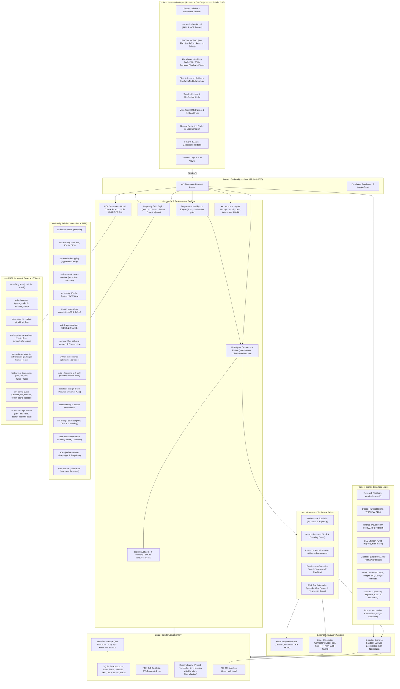

# LOCAL AI AGENT WORKSPACE — ARCHITECTURE MINDMAP
*(Updated: Google Antigravity Parity Edition — Skills, MCP, Project Switching & Full CRUD)*

---

## 1. Phân Tầng Kiến Trúc Toàn Diện (Antigravity Operating Model)

### Tầng 1: Presentation (React 19 + TypeScript + Vite + TailwindCSS)
- **Cổng truy cập**: `http://localhost:5173/` (hoặc Tauri Desktop Shell).
- **Project Switcher (TopBar)**:
  - Cho phép người dùng chọn bất kỳ thư mục dự án nào trên đĩa cứng (`H:\AiLocal`, `H:\ShopeeTool`, etc.) để tập trung phát triển độc lập.
  - Dropdown hiển thị danh sách dự án gần đây (tự động loại bỏ thư mục tạm đã xóa), nút "+ Mở Thư Mục Khác", nút "+ Tạo Dự Án Mới".
- **Customizations Modal (TopBar - Icon Sliders/Sparkles)**:
  - **Tab Skills**: Quản lý toàn diện hệ thống quy tắc thông minh, đọc và chỉnh sửa `SKILL.md`, bật/tắt kích hoạt, thêm mới skill dự án hoặc skill toàn cục.
  - **Tab MCP Servers**: Quản lý kết nối các máy chủ công cụ giao thức bối cảnh mô hình (Model Context Protocol), kiểm tra kết nối (Ping JSON-RPC 2.0), khám phá danh mục tool và chạy thử nghiệm trực tiếp.
- **File Tree & Code Editor CRUD**:
  - Hỗ trợ tạo file mới (`+ File`), tạo thư mục mới (`+ Folder`), đổi tên (Rename), xóa an toàn (Delete) ngay trên giao diện cây thư mục.
  - Trình đọc & sửa mã nguồn trực tiếp (FileViewer): theo dõi trạng thái chưa lưu (dirty state), nút "Lưu thay đổi (Tạo Checkpoint)" tự động tạo bản lưu vết an toàn trước khi ghi đĩa.
- **Chat & Anti-Hallucination Grounding**:
  - Tích hợp Grounded Citation Pills; mô hình chỉ trả lời dựa trên bằng chứng đã đọc từ workspace/tài liệu và các Skill đang được kích hoạt; minh bạch thừa nhận khi chưa có thông tin thay vì đoán mò.

### Tầng 2: Backend API & Gateway (FastAPI)
- **Cổng truy cập**: `http://127.0.0.1:8765/` (100% Cục bộ, cô lập hoàn toàn khỏi mạng ngoài).
- **Bảo mật**: Mọi truy cập file tuân thủ `SecurityBroker.validate_workspace_path` chống triệt để Path Traversal.

### Tầng 3: Antigravity Skills Engine (`SkillManager`)
- **Lưu trữ**: Bảng SQLite `skills` (hỗ trợ `workspace_id` riêng hoặc toàn cục `NULL`).
- **4 Built-in Core Skills**:
  1. `clean-code`: Tuân thủ triệt để nguyên lý Uncle Bob, SOLID, DRY, đặt tên rõ ràng, hàm ngắn gọn.
  2. `systematic-debugging`: Quy trình gỡ lỗi 4 bước (tái hiện lỗi, đặt giả thuyết, kiểm chứng nguyên nhân gốc rễ, viết test chặn lặp lại).
  3. `codebase-mindmap-sentinel`: Người bảo hộ kiến trúc, duy trì `docs/mindmap.md`, đảm bảo 0 regression và cô lập sandbox `temp_test_runs/`.
  4. `anti-hallucination-grounding`: Chống đoán mò, bắt buộc kiểm tra file và trích dẫn bằng chứng xác thực trước khi kết luận.
- **Dynamic Context Injection**: Tự động ghép nối các chỉ dẫn từ các skill đang `enabled = 1` vào system prompt trước khi gửi đến mô hình LLM.

### Tầng 4: Model Context Protocol Subsystem (`MCPManager`)
- **Giao thức**: Chuẩn JSON-RPC 2.0 qua cơ chế vận chuyển `stdio` cục bộ.
- **3 Built-in Local MCP Servers**:
  1. `local-filesystem`: Cung cấp công cụ `read_file`, `list_directory`, `search_codebase` trong ranh giới an toàn.
  2. `sqlite-inspector`: Cung cấp công cụ `inspect_schema`, `execute_query` để kiểm toán dữ liệu.
  3. `git-sentinel`: Cung cấp công cụ `git_diff_audit`, `git_log` để truy vết lịch sử thay đổi.
- **Kiểm tra & Thực thi**: Hỗ trợ Ping kiểm tra trạng thái và gọi tool trực tiếp từ API và UI.

### Tầng 5: Workspace & Project Manager (`WorkspaceManager`)
- Quản lý đa dự án, lưu vết lịch sử mở gần nhất.
- Tự động thanh lọc các đường dẫn không tồn tại trên ổ cứng.
- Cung cấp API CRUD đầy đủ: tạo file, tạo thư mục, đổi tên, cập nhật nội dung kèm diff checkpoint rollback.

### Tầng 6: Safe Execution Broker & Checkpoints
- **Sandbox Boundary**: Chặn đứng Path Traversal ra ngoài thư mục workspace.
- **Rollback an toàn**: Mọi thao tác ghi/xóa file đều tạo checkpoint nguyên tử tại `storage/checkpoints/` trước khi thực thi.
- **Terminal Execution**: Chỉ chạy các binary trong allowlist (`ALLOWED_EXECUTABLES = ["python", "pytest", "git", "cargo", "npm", "node"]`).
- **Command Injection Guard**: Thực thi dạng argument list (`shell=False`), không nối chuỗi.
- **Audit Logger**: Tự động che giấu mật khẩu, API keys, GitHub tokens (`ghp_...`).

### Tầng 7: Requirement Intelligence Gate
- Phân tách mục tiêu, phạm vi, ràng buộc, phát hiện mơ hồ và phê duyệt tác vụ nhạy cảm qua 5 bước nghiêm ngặt.

### Tầng 8: Multi-Agent Orchestrator & Task DAG Planner
- Phân tách TaskSpec thành đồ thị không chu trình (DAG), 5 vai trò chuyên trách (`Orchestrator`, `Security Reviewer`, `Research Specialist`, `Development Specialist`, `QA Specialist`), quản lý khóa đồng thời `FileLockManager`, cô lập sự cố khi subtask thất bại.

### Tầng 9: Domain Expansion Platform (8 Core Domains)
- 8 Domain độc lập (`research`, `design`, `finance`, `ceo_strategy`, `marketing`, `media`, `translation`, `browser_automation`) kèm giấy phép mã nguồn mở thân thiện 100% (MIT/Apache).

### Tầng 10: Conversation Manager & Batch Deletion (`ChatManager`)
- **Quản lý phiên trò chuyện**: Khởi tạo, đổi tên, hiển thị danh sách và xóa từng phiên chat kèm toàn bộ tin nhắn liên quan.
- **Batch Deletion (Xóa hàng loạt)**: Hỗ trợ chọn cùng lúc nhiều cuộc trò chuyện hoặc chọn tất cả (`Select All`), xóa nguyên tử hàng loạt qua API `POST /api/v1/chat/conversations/batch-delete` với SweetAlert2 xác nhận an toàn.
- **Giao diện Chống Vỡ/Rớt Chữ**: Sidebar `w-80` (320px), header 2 tầng phân lập rõ ràng, thuộc tính `whitespace-nowrap shrink-0` trên toàn bộ nút bấm và huy hiệu, thanh công cụ chọn hàng loạt trực quan.

### Tầng 11: Multimodal & Document Intelligence Subsystem (`MediaParser`)
- **Trích xuất & Phân tích Đa Phương Tiện**:
  - **Hình ảnh (`.png`, `.jpg`, `.webp`, `.gif`, v.v.)**: Trích xuất kích thước `width x height`, định dạng, hệ màu, hướng khung hình (Ngang/Dọc/Vuông), tạo thumbnail preview Base64 tức thì.
  - **Video (`.mp4`, `.mov`, `.mkv`, `.webm`, v.v.)**: Tích hợp công cụ `ffprobe` và `ffmpeg` trích xuất thời lượng, độ phân giải, video/audio codec, tốc độ khung hình (fps), bitrate và tạo ảnh keyframe trích xuất tiêu biểu; đánh giá độ tương thích nền tảng (TikTok/Shorts dọc 9:16 vs YouTube ngang 16:9).
  - **Tài liệu & PDF (`.pdf`, `.csv`, `.md`, `.json`, `.py`, `.ts`, v.v.)**: Sử dụng thư viện `pypdf` đọc cấu trúc trang và trích xuất nội dung văn bản đa trang; phân tích bảng dữ liệu CSV; nạp nội dung tài liệu làm ngữ cảnh phân tích cốt lõi (Grounded Context) cho mô hình LLM.
- **Trải Nghiệm Tương Tác Hiện Đại**: Hỗ trợ nút đính kèm kẹp giấy (<kbd>📎</kbd>), kéo thả tệp trực quan (Drag & Drop) và dán ảnh/tệp trực tiếp từ bộ nhớ tạm (<kbd>Ctrl+V</kbd>).

---

## 2. Toàn Bộ Danh Mục Endpoint API Đã Triển Khai (Phases 0 - 8)

| Method | Endpoint | Module | Quyền yêu cầu | Mô tả |
| :--- | :--- | :--- | :--- | :--- |
| `GET` | `/api/v1/health` | System | None | Sức khỏe backend, trạng thái Ollama RTX 2070 |
| `GET` | `/api/v1/system/info` | System | None | CPU, RAM, Disk, tài nguyên hệ thống |
| `GET` | `/api/v1/workspace/list` | Workspace | None | Danh sách các dự án đã đăng ký (tự prune đường dẫn chết) |
| `POST` | `/api/v1/workspace/open` | Workspace | `workspace.read` | Mở và xác thực thư mục dự án an toàn |
| `POST` | `/api/v1/workspace/create` | Workspace | `workspace.write` | Tạo thư mục dự án mới trên đĩa và mở dự án |
| `DELETE` | `/api/v1/workspace/{id}` | Workspace | None | Xóa dự án khỏi danh sách gần đây |
| `GET` | `/api/v1/workspace/tree` | Workspace | `workspace.read` | Cây thư mục dự án |
| `POST` | `/api/v1/workspace/search` | Workspace | `workspace.read` | Tìm kiếm FTS5 siêu tốc trong dự án |
| `POST` | `/api/v1/workspace/file/create` | Workspace | `workspace.write` | Tạo file mới trong dự án |
| `POST` | `/api/v1/workspace/file/mkdir` | Workspace | `workspace.write` | Tạo thư mục con mới trong dự án |
| `POST` | `/api/v1/workspace/file/rename` | Workspace | `workspace.write` | Đổi tên file hoặc thư mục trong dự án |
| `POST` | `/api/v1/workspace/file/update` | Workspace | `workspace.write` | Lưu chỉnh sửa file kèm diff checkpoint rollback |
| `GET` | `/api/v1/skills` | Skills | None | Danh sách tất cả skills (lọc theo workspace hoặc global) |
| `GET` | `/api/v1/skills/{id}` | Skills | None | Xem chi tiết quy tắc và chỉ dẫn `SKILL.md` |
| `POST` | `/api/v1/skills` | Skills | None | Tạo mới một Skill thông minh |
| `PUT` | `/api/v1/skills/{id}` | Skills | None | Cập nhật tên, mô tả, nội dung `SKILL.md` |
| `POST` | `/api/v1/skills/{id}/toggle` | Skills | None | Bật / tắt kích hoạt Skill |
| `DELETE` | `/api/v1/skills/{id}` | Skills | None | Xóa Skill tùy chỉnh (bảo vệ Built-in skills) |
| `GET` | `/api/v1/mcp/servers` | MCP | None | Danh sách các MCP server cục bộ và danh mục công cụ |
| `POST` | `/api/v1/mcp/servers` | MCP | None | Đăng ký thêm MCP server mới (stdio) |
| `PUT` | `/api/v1/mcp/servers/{id}` | MCP | None | Cập nhật cấu hình command/args/env của MCP server |
| `DELETE` | `/api/v1/mcp/servers/{id}` | MCP | None | Hủy đăng ký MCP server |
| `POST` | `/api/v1/mcp/servers/{id}/ping` | MCP | None | Ping kiểm tra kết nối JSON-RPC 2.0 tới MCP server |
| `POST` | `/api/v1/mcp/servers/{id}/execute` | MCP | None | Chạy thử nghiệm công cụ của MCP server |
| `POST` | `/api/v1/chat/upload` | Multimodal | `workspace.write` | Tải lên và phân tích hình ảnh, video (ffprobe/ffmpeg), tài liệu PDF/Code |
| `POST` | `/api/v1/chat/message` | Chat | `workspace.read` | Hội thoại cục bộ (tự động nạp Skill instructions & attachments) |
| `GET` | `/api/v1/chat/messages` | Chat | `workspace.read` | Lịch sử tin nhắn theo cuộc hội thoại |
| `GET` | `/api/v1/chat/conversations` | Chat | None | Danh sách tất cả các phiên trò chuyện trong workspace |
| `POST` | `/api/v1/chat/conversation` | Chat | None | Khởi tạo phiên trò chuyện mới |
| `PUT` | `/api/v1/chat/conversation/{id}` | Chat | None | Đổi tên phiên trò chuyện |
| `DELETE` | `/api/v1/chat/conversation/{id}` | Chat | None | Xóa đơn lẻ phiên trò chuyện và toàn bộ tin nhắn liên quan |
| `POST` | `/api/v1/chat/conversations/batch-delete` | Chat | None | Xóa hàng loạt nhiều phiên trò chuyện trong 1 giao dịch nguyên tử |
| `DELETE` | `/api/v1/chat/conversations/clear` | Chat | None | Xóa toàn bộ lịch sử trò chuyện trong workspace |
| `POST` | `/api/v1/requirements/analyze` | Requirement | `workspace.read` | Phân tích 5 bước, tạo Task Specification |
| `POST` | `/api/v1/requirements/clarify` | Requirement | `workspace.read` | Trả lời câu hỏi làm rõ |
| `POST` | `/api/v1/requirements/approve` | Requirement | None | Phê duyệt hoặc từ chối tác vụ nguy hiểm |
| `GET` | `/api/v1/requirements/tasks/{id}` | Requirement | None | Chi tiết Task Spec |
| `GET` | `/api/v1/requirements/tasks/{id}/versions` | Requirement | None | Lịch sử phiên bản Task Spec |
| `POST` | `/api/v1/execution/file/write` | Execution | `workspace.write` | Ghi file an toàn kèm checkpoint diff |
| `POST` | `/api/v1/execution/file/delete` | Execution | `workspace.delete` | Xóa file an toàn kèm checkpoint |
| `POST` | `/api/v1/execution/rollback` | Execution | `workspace.write` | Rollback file về checkpoint trước đó |
| `POST` | `/api/v1/execution/terminal/run` | Execution | `terminal.execute` | Chạy lệnh trong sandbox allowlist |
| `GET` | `/api/v1/execution/audit` | Execution | None | Tra cứu audit log có che giấu secrets |
| `POST` | `/api/v1/crawler/jobs` | Crawler | `network.fetch` | Crawl web / file nguồn với SSRF guard |
| `GET` | `/api/v1/crawler/documents` | Crawler | `workspace.read` | Tra cứu tài liệu và nguồn trích dẫn |
| `POST` | `/api/v1/memory/project` | Memory | `workspace.write` | Lưu quyết định kiến trúc vào Project Memory |
| `GET` | `/api/v1/memory/project` | Memory | `workspace.read` | Đọc quyết định kiến trúc |
| `POST` | `/api/v1/memory/errors` | Memory | None | Ghi nhận lỗi và giải pháp vào Error Memory |
| `POST` | `/api/v1/memory/errors/lookup` | Memory | None | Tìm kiếm lỗi tương tự chống lặp lại |
| `POST` | `/api/v1/qa/run` | QA Agent | `terminal.execute` | Chạy tự động test suite kiểm tra regression |
| `POST` | `/api/v1/retention/cleanup` | Retention | None | Tự động dọn thư mục tạm (48h TTL) |
| `POST` | `/api/v1/orchestrator/plan` | Orchestrator | `workspace.read` | Tạo kế hoạch DAG subtask |
| `GET` | `/api/v1/orchestrator/plans/{id}` | Orchestrator | `workspace.read` | Lấy kế hoạch DAG và tiến độ subtasks |
| `POST` | `/api/v1/orchestrator/execute/{id}` | Orchestrator | `workspace.read` | Thực thi/resuming DAG plan |
| `POST` | `/api/v1/orchestrator/cancel/{id}` | Orchestrator | None | Hủy thực thi kế hoạch |
| `GET` | `/api/v1/orchestrator/agents` | Orchestrator | None | Danh sách 5 specialist agents và quyền hạn |
| `GET` | `/api/v1/domains` | Domains | None | Danh sách 8 core domains và capability manifests |
| `GET` | `/api/v1/domains/{id}` | Domains | None | Chi tiết capability manifest của domain |
| `GET` | `/api/v1/domains/{id}/license-audit` | Domains | None | Kiểm toán an toàn bản quyền permissive |
| `POST` | `/api/v1/domains/{id}/execute` | Domains | Domain Specific | Thực thi tác vụ domain với xác thực quyền |
| `GET` | `/api/v1/system/drives` | System | None | Danh sách ổ đĩa trên máy tính kèm dung lượng trống |
| `POST` | `/api/v1/system/browse-directory` | System | None | Duyệt thư mục trực quan với breadcrumbs và tag nhận diện project |
| `POST` | `/api/v1/system/create-directory` | System | `workspace.write` | Tạo thư mục mới trên ổ đĩa từ modal Folder Explorer |
| `PUT` | `/api/v1/chat/conversation/{id}` | Chat | None | Đổi tên phiên trò chuyện trong workspace |
| `DELETE` | `/api/v1/chat/conversation/{id}` | Chat | None | Xóa phiên trò chuyện và toàn bộ lịch sử tin nhắn |
| `POST` | `/api/v1/chat/conversations/batch-delete` | Chat | None | Xóa hàng loạt nhiều phiên trò chuyện trong 1 transaction |
| `DELETE` | `/api/v1/chat/conversations/workspace/{id}` | Chat | None | Xóa toàn bộ lịch sử chat của workspace |
| `POST` | `/api/v1/chat/upload` | Chat / Media | `workspace.write` | Phân tích và trích xuất tài liệu/đa phương tiện (ảnh, video, audio, pdf, docx, xlsx) |
| `POST` | `/api/v1/workspace/reindex` | Workspace | `workspace.read` | Đồng bộ hóa và tái lập chỉ mục SQLite FTS5 |

---

## 3. Trạng Thái Hoàn Thành & Tiêu Chuẩn Kiểm Thử

- **Phase 0 — Audit & Planning**: ✅ COMPLETED (Phần cứng, CUDA 13.4, SQLite FTS5 benchmark 3.5ms, 5/5 tests pass).
- **Phase 1 — Workspace & Local Chat**: ✅ COMPLETED (FastAPI, Ollama Qwen3-4B local, FTS5 search, 10/10 tests pass).
- **Phase 2 — Requirement Intelligence**: ✅ COMPLETED (5-step engine, TaskSpec schema, Clarification UI, 5/5 tests pass).
- **Phase 3 — Safe Execution & Sandbox**: ✅ COMPLETED (ExecutionBroker, Checkpoints & Rollback, Audit logging, 5/5 tests pass).
- **Phase 4 — Crawl & Knowledge Acquisition Engine**: ✅ COMPLETED (SSRF guard, Deduplication, Untrusted tags, 5/5 tests pass).
- **Phase 5 — Development, QA, Memory & Retention**: ✅ COMPLETED (Project/Error Memory, QA Runner, 48h TTL purge, 5/5 tests pass).
- **Phase 6 — Multi-Agent Orchestrator**: ✅ COMPLETED (DAG Planner, Agent Registry, FileLockManager, Blocked propagation, 5/5 tests pass).
- **Phase 7 — Domain Expansion**: ✅ COMPLETED (8 Core Domains, Permissive License Shield, Deterministic Handlers, 5/5 tests pass).
- **Phase 8 — Google Antigravity Parity**: ✅ COMPLETED (Multi-Project Switcher, Skills Engine & SKILL.md, MCP JSON-RPC 2.0 Subsystem, File Tree & Editor Full CRUD, Grounded Anti-Hallucination, 4/4 tests pass).
- **Phase 9 — Visual Explorer & SweetAlert2 UX Redesign**: ✅ COMPLETED (FolderPickerModal with Windows drive detection & breadcrumbs, SweetAlert2 dark glassmorphism theme, tabbed Activity Sidebar).
- **Phase 10 — Conversation CRUD, Grounding Resilience & Orchestrator Pro**: ✅ COMPLETED (Inline rename, batch delete, file viewer resilient rendering, SweetAlert2 across all actions).
- **Phase 11 — Multilingual Grounding, Multimodal Ingestion & Text Copy**: ✅ COMPLETED:
  1. **Multilingual Consistency**: Language detection (`is_vietnamese`), bilingual system prompt and Vietnamese language directives that eliminate English anchoring on quantized LLMs (`qwen3:4b`).
  2. **Multimodal Attachments Engine**: Local `MediaParser` supports images, video metadata, audio inspection, PDF, DOCX, XLSX text extraction with zero cloud dependencies.
  3. **Chat UX Pro**: Rich markdown rendering with language badge, syntax highlighting, dedicated copy button per code block, full chat copy, and multi-select batch conversation deletion.
  4. **One-Click Startup Scripts**: `run.bat` and `run.ps1` for starting Ollama, FastAPI backend, and Vite frontend simultaneously.

**Tổng số bài kiểm thử tự động**: **52/52 tests PASSED (100%)** với **0 failures, 0 regressions**.
